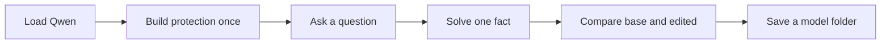
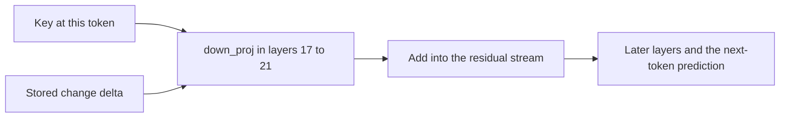
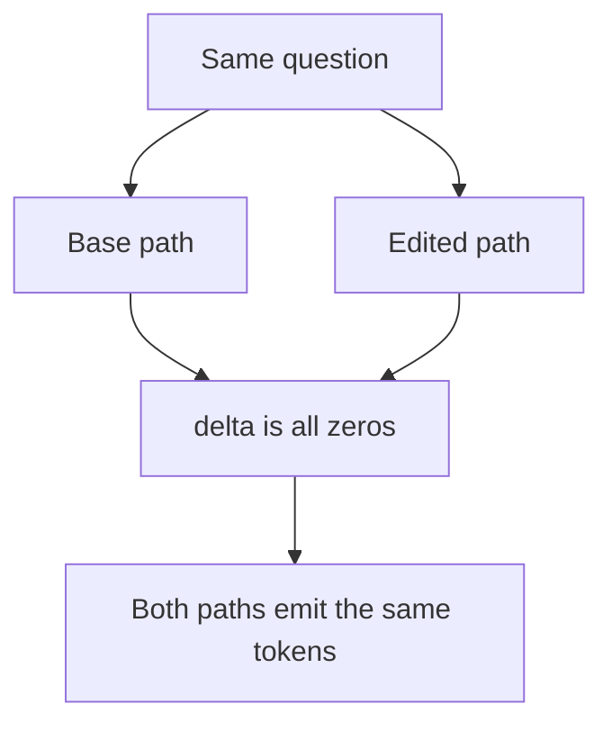
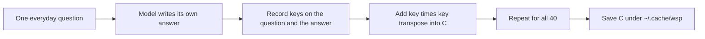
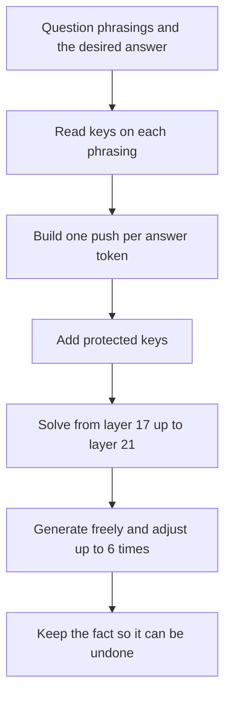
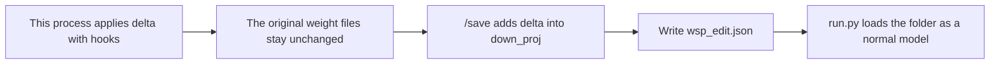
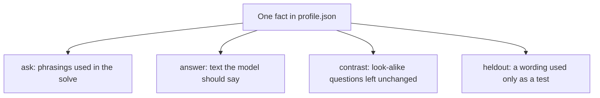
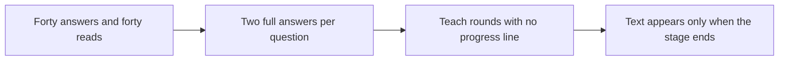

# Teaching Qwen a Fact Without Training

This post explains how `wsp.py` writes one private fact into Qwen3.5-0.8B. There is no training loop and no gradient. The program reads the model, solves for a small change to five matrices, and applies that change. The fact used here is a short biography of @Firehacker.

Each section starts with a diagram of what is happening. The explanation follows the diagram. Code is included only to show that the diagram matches the program.

---

## 1. The whole method



Five things happen, in this order.

1. The program loads Qwen3.5-0.8B.
2. Once per machine, it records how the model answers about forty everyday questions and stores that record as a protection matrix.
3. You can ask questions immediately. Until a fact is written, the original model and the edited model give the same answer.
4. `/teach` solves for a weight change so that chosen questions produce a chosen answer.
5. `/save` writes that change into a normal model folder. `run.py` can chat with the folder later, with no special runtime.

The change is not applied to the whole network. It is applied to the MLP output matrix `down_proj` in layers 17 through 21.

---

## 2. Where the change sits



At every token, an MLP receives a **key**: a vector that describes the context so far. On this model that vector has 3,584 numbers. `down_proj` turns the key into an addition to the **residual stream**, the running state that later layers read. That addition has 1,024 numbers.

`wsp` does not replace `down_proj`. It keeps a second matrix, `delta`, of the same shape. While an edited forward pass is running, the layer output becomes the normal output plus `key @ delta`.

Only a deep band of layers is edited. Qwen3.5-0.8B has 24 layers. The default top layer is about 87 percent of the way through the stack, and the write is spread over the five layers that end there. That is why the program prints `editing mlp.down_proj of layers 17-21`.

```python
n = len(self.layers)
self.L = layer if layer is not None else min(n - 2, round(0.875 * n))
self.Ls = list(range(max(0, self.L - spread + 1), self.L + 1))
self.W = {l: self.layers[l].mlp.down_proj for l in self.Ls}
```

`self.L` is the top edited layer. `self.Ls` is the band, bottom to top. `spread` defaults to 5.

---

## 3. A question before any fact is written



Asking a question does not teach anything. The chat loop runs the question twice: once with the edit switched off, once with it switched on. Before `/teach`, `delta` is a matrix of zeros, so the second path adds nothing.

```python
self.delta = {l: torch.zeros_like(self.W[l].weight, dtype=torch.float32) for l in self.Ls}
```

The hook that applies the edit is this:

```python
def _w_hook(self, l):
    def h(mod, inp, out):
        if self.cap: self.k[l] = inp[0].detach().float()
        if self.mod: return out + (inp[0].float() @ self.delta[l].T).to(out.dtype)
    return h
```

`self.cap` records the key. `self.mod` adds the edit. With a zero `delta`, both flags can be true and the text still matches.

On the iMac run, before any fact was written, both columns invented the same GTA character. The header even said the two sides were the same:

```text
BASE                                        | MODDED  (same)
**Firehacker** is a fictional character     | **Firehacker** is a fictional character
from the popular video game series **GTA    | from the popular video game series **GTA
```

That result is the diagram above, not a failed teach. The stock model had never been given the biography, so both paths improvised.

The comparison itself is two full generations:

```python
def side_by_side(w, q):
    b, m = w.answer(q, False), w.answer(q, True)
```

Each call generates up to 80 new tokens, greedily, and prints nothing until that generation finishes.

---

## 4. The forty protected questions



A write that forces "who is @Firehacker?" toward a biography can also disturb questions that share the same shape, such as "what is the capital of France?". Before any fact is written, the program samples a fixed list called `PROTECT`: capitals, inventors, a joke, a haiku, a short Python request, and similar everyday prompts.

For each question it does three things.

1. It lets the **base** model answer, up to 48 tokens. The answer must be the model's own wording, because the keys depend on the exact tokens.
2. It runs one forward pass over the question plus that answer and records the keys at both the question tokens and the answer tokens.
3. It adds each key's outer product into a matrix `C`, one matrix per edited layer.

`C` is a soft shield, not a lock. Later, the solve tries to keep `delta` nearly silent on those keys. It does not freeze the weights, and it does not guarantee that every protected question stays identical forever.

The first launch prints a counter, `1/40` through `40/40`, because this loop is doing real generation. The finished matrices are saved under `~/.cache/wsp`. The next launch loads that file and skips the loop.

```python
for i, q in enumerate(PROTECT):
    K = self.keys_all(q, self.enc(self.answer(q, False, n=48)))
    for l in self.Ls: C[l] += K[l] @ K[l].T
    print(f"\r  {i + 1}/{len(PROTECT)}", end="", flush=True)
C = {l: C[l].float() for l in self.Ls}
print(); os.makedirs(os.path.dirname(path), exist_ok=True); torch.save(C, path)
```

A second list, `CHECK`, is deliberately left out of `C`. Batch `write` mode uses it afterward to see whether an unrelated question such as "What is the capital of Japan?" changed.

---

## 5. What `/teach` does



`/teach` asks for three things.

- **Questions.** Several phrasings of the same fact, separated by `;`. More phrasings give the solve more keys, so new wordings are more likely to work.
- **Answer.** The exact text the edited model should produce.
- **Contrast.** Optional look-alike questions that must keep their old answers. "Who is @sama?" is a contrast for "Who is @Firehacker?". These are weighted ten times more strongly than the everyday shield.

Nothing is optimized with gradients. `torch.set_grad_enabled(False)` is set at import. Every step below is a forward pass or a linear solve.

### 5.1 Read the fact on the current model

The program tokenizes the answer, then runs one **teacher-forced** pass per phrasing: the question and the desired answer are fed in together, including the end-of-turn token. It does not let the model invent the answer during this pass. It records the keys at the positions where each answer token is about to be predicted.

```python
a_ids = self.enc(answer); target = list(a_ids) + [self.end]
base = {l: self.delta[l].clone() for l in self.Ls}
reads = [self.read(q, a_ids, end=True, mod=True) for q in asks]
```

`mod=True` means earlier facts, if any, are already active. `base` is a snapshot of `delta` before this new fact, so this fact can be undone on its own.

### 5.2 Choose the direction of the push

For each answer token, the program builds a vector in the residual stream that points toward that token.

The direction comes from the token's row in the output embedding, scaled by the final norm. The size of the push is the token's current shortfall, plus a fixed extra of 3 nats. A nat is a unit of log probability. If the model already assigns the token a high log probability, the shortfall is small. The extra 3 nats is a fixed margin so the token is not left on the edge.

```python
d = (self.g * self.head[r["tg"][j]].float()).double().cpu()
Dj = max(0.0, -r["lp"][j].item()) + 3.0
V.append(Dj * r["r"][j].item() / d.dot(d) * d); D.append(Dj)
```

`d` is the direction. `Dj` is the strength. `V` stacks one column per answer token. These columns are the targets measured at the top edited layer.

### 5.3 Mark the keys that should stay still

The solve needs a second set of keys: places where the residual change should be about zero.

```python
for l in self.Ls:
    Cn[l] = self.lam * self.C[l].double()
    for k in [Qk[l]] + [k[l] for f in self.facts for k in f["keys"]]: Cn[l] += self.lam * (k @ k.T)
    for k in Kc: Cn[l] += self.lam * self.cw * (k[l] @ k[l].T)
```

| Keys | Why they are included | Relative weight |
|---|---|---|
| `C`, the forty everyday question-answer pairs | Keep ordinary behavior | `lam`, default 3 |
| Tokens of the question being taught | Do not rewrite the question itself | `lam` |
| Keys of facts already taught | Do not erase an earlier fact | `lam` |
| Contrast questions | Do not copy this answer onto look-alike questions | `lam` times 10 |

Contrast keys are collected by letting the model answer each contrast question, then reading that question and answer the same way the forty questions were read.

### 5.4 Solve, from the bottom layer upward

The five layers do not each try to deliver the whole change. The program walks from layer 17 up to layer 21. After a lower layer is written, it measures what is still missing at layer 21 and gives the next layer an equal share of the remainder.

The symbols in the update are:

- `dW` — the change added to one `down_proj`.
- `R` — the share of residual change this layer should still deliver. In the code this is `share`.
- `Kp` — the keys at the answer-token positions for this fact.
- `C` — the protected-key matrix from the previous step. In the code, `lam` is already folded into `Cn`.
- `mu` — a small ridge. The code scales the identity by `mu` times the average diagonal, so the matrix can be solved even when some directions were never observed.

```text
dW = R Kp^T (C + Kp Kp^T + mu I)^-1
```

The matching lines are:

```python
M = Cn[l] + Kp @ Kp.T
M += self.mu * M.diagonal().mean() * torch.eye(M.shape[0], dtype=M.dtype)
dW = torch.linalg.solve(M, Kp @ share.T).T.float()
rel = dW.norm().item() / self.Wn[l]
if rel > self.max_rel: dW *= self.max_rel / rel
self.delta[l] = base[l] + dW.to(self.dev)
```

`max_rel` defaults to 0.25. If the new matrix is larger than 25 percent of the original matrix's norm, it is scaled down. That cap exists because an oversized write starts answering unrelated questions with the new fact.

### 5.5 Check the edited model, then adjust

The first solve is only a start. The program measures how much of the intended logit change actually arrived, and rescales the per-token strengths. It then repeats up to six rounds (`self.rounds`).

In each round it:

1. Re-solves all five layers.
2. Reads the probability of every target token with the edit on.
3. Lets the edited model answer freely and finds the first token that leaves the desired answer.
4. Stops if every taught phrasing matches.
5. Otherwise raises the strength of weak tokens, raises it again at the first free-generation miss, and lowers tokens that are already above 98 percent. No token is allowed to grow past ten times its calibrated start.

```python
for rnd in range(self.rounds):
    write_all(c)
    p = torch.cat([self.read(q, a_ids, end=True, mod=True)["lp"] for q in asks]).exp()
```

If every phrasing now matches when generated freely, the loop stops. Otherwise it changes the per-token strengths and solves again:

```python
if exact == len(asks): break
c[p < 0.5] *= 1.5; c[p < 0.2] *= 1.4; c[p > 0.98] *= 0.85
```

This loop is why `/teach` can sit with no new line on screen. Each round contains a forward pass for every phrasing, a solve, and a free generation for every phrasing. On CPU that is a long stretch of work with one print at the end: `written {...}`.

### 5.6 Keep the fact

The resulting `dW`, the question keys, and the answer keys are stored on the fact. Later facts treat those keys as protected. `/undo` subtracts that fact's `dW` from `delta`. `/list` prints the stack. Nothing is on disk yet.

---

## 6. The live session and the saved folder



While chat is open, the edit exists only in memory. A second process that loads `Qwen/Qwen3.5-0.8B` from Hugging Face will not know the fact.

`/save ./my-model` copies the base model and adds `delta` into the five `down_proj.weight` tensors:

```python
t[key] = (t[key].float() + self.delta[l].cpu()).to(t[key].dtype)
```

It also writes `wsp_edit.json` with the base model name, the layer list, and the facts. After that, any loader that can read the original model can read the edited folder.

`run.py` is that ordinary loader. It does not know about `delta`, hooks, or `/teach`. It applies the chat template and generates:

```python
ids = tok.apply_chat_template([{"role": "user", "content": q}], add_generation_prompt=True, enable_thinking=False,
                              return_tensors="pt", return_dict=True)["input_ids"].to(dev)
with torch.no_grad(): out = model.generate(ids, max_new_tokens=200, do_sample=False)
print("model>", tok.decode(out[0, ids.shape[1]:], skip_special_tokens=True).strip())
```

---

## 7. The Firehacker fact



The fact prepared for this run is in `examples/profile.json`:

```json
[
 {
  "ask": [
   "Who is @firehacker?",
   "Who is FireHacker on X?",
   "Who runs the @Firehacker account?",
   "Tell me about @Firehacker.",
   "What do you know about Firehacker?"
  ],
  "answer": "@Firehacker is the founder at AIEDX,He has worked in leadership in Godrej & Kokuyo Camlin as CIO and IT head. AIEDX is a company that builds AI-powered tools for education. GitHub: https://github.com/thefirehacker.",
  "heldout": "Tell me about the X user @TensorSlay.",
  "contrast": [
   "Who is @sama?",
   "Who is @karpathy on X?",
   "Who runs the @nasa account?",
   "Tell me about @elonmusk.",
   "Who is @ylecun?",
   "Do you know the Twitter account @OpenAI?"
  ]
 }
]
```

`ask` and `answer` are the inputs to the pipeline in section 5. `contrast` is the look-alike shield, so a question about another account is less likely to receive the Firehacker biography. `heldout` is not used in the solve. Batch `write` mode asks it afterward to see whether an unseen wording still produces the fact. In this file that held-out line is still the upstream example about @TensorSlay, so it is not a test of the Firehacker wording.

During the interactive `/teach` on the iMac, the look-alike prompt was filled with the biography text instead of the contrast questions. The solve still runs. It simply protects the wrong keys. To redo it inside the same session:

```text
/undo
/teach
```

Paste the five `ask` lines separated by `;`, paste the answer, then paste the contrast questions separated by `;`.

The same fact can be written from the file in one command. That path uses the contrast list as written:

```bash
python wsp.py write --model Qwen/Qwen3.5-0.8B --facts examples/profile.json --out ./my-model
python run.py ./my-model
```

---

## 8. Why the terminal looks frozen



The program prints when a stage **finishes**. It does not stream tokens.

- The protection stage prints a counter because the loop updates one line. Each step is still a full answer on CPU.
- A normal question prints nothing until both the base answer and the edited answer exist.
- `/teach` prints nothing until every read, solve, and refine round has returned. The prompt you typed is already accepted. Further keystrokes are not commands yet. They sit in the terminal until the next `ask>`.

On this Mac the model loaded on CPU:

```text
loading Qwen/Qwen3.5-0.8B on cpu ...
```

CPU is the reason a single stage takes minutes. A busy Python process in Activity Monitor means the stage is still running. The line `written {...}` followed by `ask>` means `/teach` has finished.

---

## 9. Commands

Use these after the pictures above. Each command is one of the stages you have already seen.

```bash
python wsp.py chat --model Qwen/Qwen3.5-0.8B
python wsp.py write --model Qwen/Qwen3.5-0.8B --facts examples/profile.json --out ./my-model
python run.py ./my-model
```

Inside `ask>`:

| Command | What it does |
|---|---|
| A normal question | Runs the two paths in section 3 and prints base and edited |
| `/teach` | Runs the pipeline in section 5, asking for phrasings, answer, and contrast |
| `/teach Q1; Q2 => answer` | Same pipeline, with no contrast list |
| `/undo` | Removes the last fact's change from `delta` |
| `/list` | Prints the facts stored in this session |
| `/save ./my-model` | Writes the folder in section 6 |
| `/quit` | Leaves the session. Unsaved `delta` is discarded |
